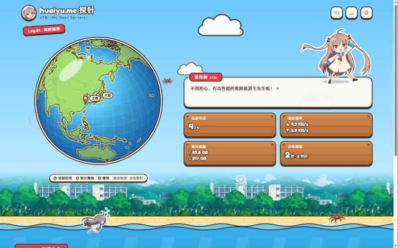

# 亚托莉 · 我挚爱的服务器（Komari 主题）

ATRI -My Dear Moments- 风格的 Komari 1.6 探针主题。只用官方小游戏「アトリの大冒険島」那一套 Q 版素材，画风统一。



- **Log.01 地球观测**：卡通旋转地球（d3-geo + canvas），节点按城市落红领结色图钉，在线脉冲、城市间虚线航线、绕地球公转的伟大的螃蟹；可拖动，悬停看节点，点击打开 Log
- **亚托莉对话框**：视觉小说式打字机台词，按状态切换（全员在线 / 离线哭哭 / CPU 高 / 内存或硬盘快满 / 深夜 / 早上）；点她或螃蟹会换表情并播放游戏语音
- **Log.02 打捞作业**：水手领卡片，条纹进度条，离线节点「沉入海底中」。节点详情支持实时和 1/6/24 小时记录，展示 CPU 与负载、内存与 Swap、独立磁盘、网络、连接数和进程数六张曲线。
- 白昼之海 / 沉没的星星（深色）两套配色，跟随 `localStorage.appearance`；手机适配

实时模式跟随探针上报更新，展示最近 10 分钟、最多 120 条记录。

## 安装

1. 从 [GitHub Releases](https://github.com/qch7/komari-theme-atri/releases/latest) 下载 `komari-theme-ATRI-v*.zip`。
2. Komari 后台 → 外观与插件 → 主题管理 → 上传安装包 → 启用。
3. 后台会多出「亚托莉设定」：固定台词、称呼（默认「夏生先生」）、语音开关、游泳的亚托莉、地球转速、航线、节点坐标覆盖、刷新间隔、离线排序。

节点位置：先看节点名里的城市（大阪、上海、Tokyo、Frankfurt…），没有就按地区旗帜落到该国常见机房城市。要精确位置就在「节点坐标覆盖」里填 JSON：

```json
{ "甲骨文大阪 a1": [34.69, 135.50], "某节点 UUID": { "lat": 22.3, "lon": 114.2, "label": "香港" } }
```

## 开发

需要 Node.js 22.12 或更高版本，以及 Python 3。安装依赖后，将 `.env.example` 复制为 `.env.local`，把 `KOMARI_TARGET` 改成自己的 Komari 地址。开发服务和打包预览服务都会读取该配置，也支持通过进程环境变量覆盖。默认地址为 `http://127.0.0.1:25774`。

```bash
npm ci
npm run dev            # http://localhost:5179，/api 代理到 KOMARI_TARGET
npm run build          # base 固定为 /themes/ATRI/dist/
npm run pack           # 打包成可安装 zip
npm run preview:dist   # http://localhost:5181，按 Komari 的托管规则预览 dist
```

重新处理角色图片时，安装 Pillow 后运行 `python -I scripts/prep_assets.py <atri_game 目录> src/assets/atri`。

GitHub Actions 会在提交和 Pull Request 中自动安装依赖、构建并打包。运行完成后可从该次工作流的 Artifacts 下载 `komari-theme-ATRI`，解压后即可取得主题安装包。

## 版权与素材来源

主题原创代码采用 [MIT 许可证](LICENSE)。第三方依赖的许可与版权信息见 [THIRD_PARTY_NOTICES.md](THIRD_PARTY_NOTICES.md)。

本项目为爱好者制作的 Komari 主题。角色立绘、背景、精灵动画、语音及音效素材来自 ATRI 官方小游戏《アトリの大冒険島》，相关版权及其他权利归原作品及各素材的权利人所有。主题对图像进行了裁剪、缩放、拼帧及 WebP 格式转换。

第三方素材的使用、修改与再分发应遵循相应权利人的授权及原始许可。

- ATRI 原作的版权声明为 © Aniplex Inc. All rights reserved. [原作官网](https://atri-mdm.com/) · [ANIPLEX.EXE 著作权指南](https://aniplex-exe.com/guidelines/)
- 动画与小游戏来源。官方小游戏为《アトリの大冒険島》。[动画官网](https://atri-anime.com/) · [小游戏页面](https://atri-anime.com/special/adventure/) · [官方发布说明](https://atri-anime.com/news/?article_id=65865)
- Fredoka 字体，© 2016 The Fredoka Project Authors，采用 SIL Open Font License 1.1。[字体项目](https://github.com/hafontia/Fredoka-One) · [许可证](https://github.com/google/fonts/blob/main/ofl/fredoka/OFL.txt)
- Twemoji Country Flags 国旗字体由 country-flag-emoji-polyfill 提供，图形源自 Twemoji，采用 CC BY 4.0。polyfill 代码采用 MIT 许可。[项目与版权说明](https://github.com/talkjs/country-flag-emoji-polyfill/blob/master/LICENSE.md) · [CC BY 4.0](https://creativecommons.org/licenses/by/4.0/)
- world-atlas 地图数据，© 2013–2019 Michael Bostock，采用 ISC 许可。[项目主页](https://github.com/topojson/world-atlas) · [许可证](https://github.com/topojson/world-atlas/blob/master/LICENSE)
